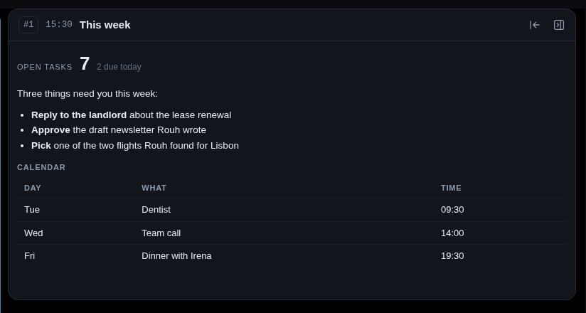

# Rouh

Rouh is a personal AI assistant that runs on a computer or server of your own.
You talk to it or type, it answers out loud, and it puts anything worth reading on a screen beside the conversation.
It does real work for you in the background (research, writing, code, mail, calendar), asks before anything that matters, and changes its own code when you ask it for something new.

Free and open source under the Apache License 2.0 (`LICENSE`, `NOTICE`).
Website and downloads: [rouh.land](https://rouh.land/).



*A card Rouh drew on the canvas, beside the conversation, with made-up data. At a desk the conversation and the canvas sit side by side; on a phone they take turns on the screen.*

## Install

Pick the machine it will run on. Both ways are free and need no account.
Expect about twenty minutes from download to talking.

**On a Mac** (Apple silicon or Intel, macOS 14 or newer, 8 GB memory, 40 GB free):
download Rouh for Mac from [rouh.land/start](https://rouh.land/start/), drag it into Applications, open it and press **Set up Rouh**.
It installs what it needs, starts Rouh, and opens it in your browser. It updates itself from then on.

**On Linux** (64-bit, Intel, AMD or ARM; Ubuntu 22.04 or 24.04, Debian 12 or 13 are tested; 4 cores, 8 GB memory and 64 GB disk to run well; SSH is enough):

```bash
curl -fsSL https://rouh.land/install.sh | sh
```

Run it as a normal user with sudo, not as root.
It says what it will install before it changes anything, installs Docker if it is missing, checks Rouh's release against its signature, starts it, and then sets Rouh up right there in the terminal.
The whole guide, with every `rouh` command, updates, backups and reaching it from a phone: [deploy/container/INSTALL-LINUX.md](deploy/container/INSTALL-LINUX.md).

**Windows** is not ready yet.

### Connected or Independent

Setup asks one question first.

- **Connected Rouh** (recommended): you make a free rouh.land account with your email.
  Your Rouh gets its own address, `https://<its name>.rouh.page`, which works from your phone anywhere, behind any router, with no port opened.
  It can share pages privately and join the Gene Pool (where Rouhs share abilities).
- **Independent Rouh**: no account anywhere. Your data stays on your machine.
  See the limits below before you choose it.

Both are free, and an Independent Rouh can be connected later.

## What you need, and what it doesn't do yet

Read this before you install. It is the honest list.

**You need:**

- **A paid API key from Anthropic or OpenAI, with credit on it.** That is Rouh's brain, and setup will not finish without one: it checks the key with a real answer.
  A new key with no credit fails. About 20 dollars of credit is a good start; you pay the company directly, and Rouh shows what each use costs.
  Google (Gemini) and xAI (Grok) keys can be added afterwards, as extra models.
- **Strongly recommended: a Claude or ChatGPT plan** for the background work (Rouh's jobs run as Claude Code or Codex).
  Without one every job runs on the API key and costs much more; setup warns you before you skip it.
- **For voice: an ElevenLabs key.** Rouh hears and speaks through ElevenLabs.
  Without it, Rouh works fully by typing.
- **Your own machine, kept on.** Rouh is not a hosted service: it runs where you installed it, and when that machine is off, Rouh is off.

**It reaches you through:** its own web page (desk and phone), Telegram, Slack, and email through your Google account (Gmail, plus Calendar, Drive and Contacts).

**It does not do yet:**

- **Local models.** Every answer comes from a cloud model provider (Anthropic, OpenAI, Google or xAI). Support for a model running on your own machine (any OpenAI-compatible server, such as Ollama or LM Studio) is coming.
- **WhatsApp, Discord or Signal.** Coming; today it is Telegram, Slack and email.
- **Windows.** Mac and Linux only for now.
- **A hosted version.** There is no "sign up and use it in the browser" Rouh. You run your own.

**What an Independent Rouh still reads from rouh.land.**
It has no account and sends nothing about you, but it downloads, like every Rouh, with nothing of yours in the request:

- the model list and prices, once a day (`rouh/modelstandard.py`);
- the starting rules every Rouh gets, once a day (`rouh/ruledefaults.py`);
- the release of what it runs on (the base image and the protected core), when Rouh for Mac or the Linux updater updates.

It never takes a new version of its own code by itself: it looks only when you press **Update** (`rouh/code_update.py`).
The servers it downloads from see its internet address, as any download does.

**An Independent Rouh has no phone address.**
It has no `rouh.page` address, so it opens only on the machine itself or on your home network.
To reach it from elsewhere, set up one of: an SSH tunnel (`rouh open` prints the line), a private network between your devices such as Tailscale or WireGuard, or your own domain (`rouh domain NAME`).
The Linux guide has each one, under "Reaching it from a phone".

Where your data is kept, and exactly what is sent to whom: [PRIVACY.md](PRIVACY.md).
Rouh sends no telemetry, analytics or crash reports anywhere.

## How it works, in one minute

- **One machine, one owner.** Rouh runs as a few containers (`deploy/stack/compose.yml`): the core (a Django app on PostgreSQL), a worker for background jobs, a key proxy that holds the API keys so jobs never see them, and a browser.
- **The conversation and the canvas.** You talk or type in the conversation; tables, charts, pages and pictures go on the canvas beside it.
- **Jobs.** Anything longer than an answer becomes a job: Claude Code or Codex in a checkout of its own, which reports back when it is done. Work is kept as tasks and steps in your own workspace, a git repository separate from this code.
- **Memory.** Synapse keeps your tasks, files, chats, contacts and the mail and calendar you connect, and finds them by meaning.
- **It asks first.** Anything that sends, buys, publishes, shares or deletes in your name waits for your yes.
- **It changes itself.** Ask for a new ability and Rouh writes it into its own code as a gene. Every change passes the protected core's checks (`guard/`), which Rouh cannot edit, and every change can be undone.
- **Models are settings, not code.** Which model answers each use is set on the Models page, from the model standard published on rouh.land.

## Running it from this repository

For working on Rouh itself, not for using it:

```bash
pyenv install 3.12.14        # the Python .python-version names
uv sync
createdb rouh                # PostgreSQL 18 with the vector and pg_trgm extensions
uv run manage.py migrate
uv run manage.py account add alex --generate
export ANTHROPIC_API_KEY=...
uv run python -m uvicorn rouh.server:app --host 127.0.0.1 --port 8021
```

`./run-local.sh` does the same on a laptop.
Every setting is an environment variable, listed with its reasoning in `rouh/config.py`; an installation's own values are in `SETUP.md`.

**If you are an AI coding agent:** read [AGENTS.md](AGENTS.md) before you change anything. It is the standing instruction for every person and agent working here: there are no committed tests, every change is proved by driving the real app in a browser, and `./e2e.sh serve` stands up a throwaway copy of Rouh with a test account and nothing that reaches the network.

## Where to read more

| File | What it is |
|---|---|
| [docs/design-notes.md](docs/design-notes.md) | How every part works and why: the long account that was this README |
| [AGENTS.md](AGENTS.md) | Rules for anyone changing the code, person or agent |
| [PRIVACY.md](PRIVACY.md) | Where data is kept, what leaves, and how long it is kept |
| [SETUP.md](SETUP.md) | Whose Rouh it is: the owner, an installation's settings, a fresh install |
| [deploy/container/INSTALL-LINUX.md](deploy/container/INSTALL-LINUX.md) | Installing and running on Linux |
| [deploy/container/README.md](deploy/container/README.md) | The containers, the base image and updates |
| [guard/README.md](guard/README.md) | The protected core: the key proxy, the checks every change passes, undo |
| [GENES.md](GENES.md) and [EVOLUTION.md](EVOLUTION.md) | Genes (Rouh's abilities) and how Rouh changes itself |
| [GOOGLE.md](GOOGLE.md) | Connecting Google with your own OAuth client |
| [MAIL.md](MAIL.md), [CAPABILITIES.md](CAPABILITIES.md), [DELEGATION.md](DELEGATION.md) | What Rouh may do for people other than its owner |
| [DECISIONS.md](DECISIONS.md) | Everything waiting on your yes, in one model |
| [PROTOCOL.md](PROTOCOL.md), [EVENTS.md](EVENTS.md), [WORK_TREE.md](WORK_TREE.md) | The page's wire protocol, the local event log, the orb's work tree |
| [one/README.md](one/README.md) | The one program, which runs Claude Code and Codex jobs |
| [CONTAINERS.md](CONTAINERS.md) | Every feature, and whether it works in the containers |

## Contributing, conduct and security

- Contributions are welcome: [CONTRIBUTING.md](CONTRIBUTING.md). Every commit is signed off under the Developer Certificate of Origin (`git commit -s`); there is no contributor agreement.
- Everyone taking part follows the [Code of Conduct](CODE_OF_CONDUCT.md).
- Found a security problem? Do not open a public issue: [SECURITY.md](SECURITY.md) says how to report it privately.
- Questions and ideas: [GitHub Discussions](https://github.com/rouh-land/rouh-core/discussions), or hello@rouh.land.

"Rouh" is a trade mark of TwoGears EOOD; the licence covers the code, not the name (`CONTRIBUTING.md`, "The name").
